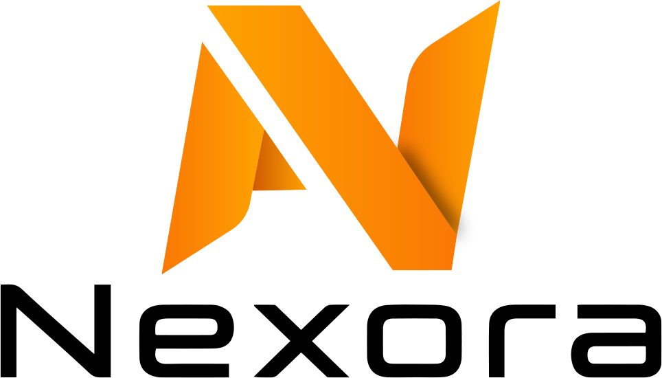

# Nexora — Connect with Modern World

<picture>
  <source media="(prefers-color-scheme: dark)" srcset="public/brand/nexora-logo-light.png">
  
</picture>

Premium, mobile-first gadget commerce system for Nexora. Built with Next.js 15, React, TypeScript and Supabase/PostgreSQL.

> **CURRENT STATE: FULL-STACK IMPLEMENTATION / CONFIGURATION PENDING.**
> Without Supabase credentials this deploys as a **non-transactional preview**. Do not collect customer data, accept payments or advertise that real checkout works yet.

## What exists in the repository

### Customer storefront
- Responsive premium storefront with an image-led promotion carousel, curated electronics categories, catalogue search, filters and a mobile-first shopping experience.
- 13 top-level gadget categories with nested subcategory landing pages, category-first homepage merchandising and mobile-friendly category browsing
- Real Supabase catalog API (owner-approved products only); demo listings shown when backend is not configured
- Shop filters: category, dynamic brand suggestions, explicit wired/wireless connectivity, BDT min/max price, in-stock only, sale only and sorting
- Filter engine has functional regression tests (`tests/shop-filters.test.mjs`); demo brands are fictional sample values, not real inventory
- Product page with images, description, technical specifications, variants, live stock, customer ratings and verified-purchase reviews (owner-moderated)
- Browser shopping cart, guest checkout, coupons, bKash / Nagad manual claims, Cash on Delivery
- Customer sign-in/sign-up, optional profile photo, delivery details, order list, and password-confirmed account deletion with anonymized order retention
- Private guest order tracking, customer order timeline, downloadable PDF invoice and automatic order-confirmation email with the PDF invoice attached (verified account email for signed-in customers; checkout email for guests)
- Consent-based browser chat history; account-synced chat history after sign-in and opt-in
- Database-grounded shopping assistant (text for guests, product images for signed-in customers)
- Optional Gemini Free Tier paraphrasing of **public verified catalog data only**, OFF by default
- Contact and policies pages with expandable FAQs and last-reviewed dates
- Dark/light theme, accessible mobile drawer, full catalog/page search, scroll progress and back-to-top control
- Optional newsletter opt-in stored in a private Supabase table; marketing email is not sent until a verified sender is configured
- Cookie/storage notice, outbound referral UTM tagging, copy controls for code blocks, and styled confirmation dialogs

### Two-owner admin
- Role-verified owner dashboard (no default password)
- Categories, product publishing, variants, images, stock adjustments and SKU data; active category visibility is shared across desktop navigation, mobile navigation, filters and direct category routes
- Orders, individual payment-claim review and overpayment alerts
- Manual refund records (does not send/refund money automatically)
- Consignment ID / tracking URL for Steadfast dispatch managed by owners
- Owner-managed storefront offers with scheduled start/end times, animated active-offer navigation, coupon-code linking and automatic expiry visibility
- Coupon creation, verified chatbot FAQs, receiving payment numbers and public notices
- Email outbox status and retry; optional Brevo Free transactional delivery

### Security primitives
- Atomic SQL checkout and stock reservations; server-derived prices
- Separate bearer-JWT verification and owner role authorization on server routes
- Row Level Security and revoked direct public table privileges
- Guest tracking tokens hashed in database; upload magic byte + size checks
- Rate limiting backed by PostgreSQL (per-window budget), idempotency keys, DB uniqueness
- Audited owner changes, payment claim reviews and refund records
- No card payment APIs, paid AI APIs or billing account integrations

## Quick preview (no credentials)

```bash
npm install
npm run typecheck
npm run build
npm run dev
```

Open http://localhost:3000. Preview catalog data is illustrative, and checkout is disabled.

## Full backend setup (later, when owners are ready)

Read **[docs/SETUP.md](docs/SETUP.md)** and **[docs/GO_LIVE_CHECKLIST.md](docs/GO_LIVE_CHECKLIST.md)**.
Apply SQL migrations in numbered order: `database/001_commerce.sql`, `002_queues_and_limits.sql`, `003_stock_and_avatar.sql`, `004_payment_reconciliation.sql`, `005_delivery_zones.sql`, `006_store_offers.sql`, `007_product_reviews.sql`, and `008_newsletter_subscribers.sql`, and `009_hierarchical_categories.sql`, then `010_account_privacy.sql`.

Never commit `.env.local`, API keys, password reset tokens, email recipient lists or real transactions.

Newsletter sign-ups require the optional `database/008_newsletter_subscribers.sql` migration. Apply it after the existing migrations. Subscriber emails are available only to owner-authorized server routes. Newsletter delivery remains disabled until a verified sender is configured.

## IMPORTANT: launch boundaries

- Website and API implementation is not the same as tested production operations. Migrations, auth, real email, courier and payment flows still require an actual Supabase instance and end-to-end testing.
- Do not set `NEXORA_LIVE_ORDERS=true` until migration tests, security verification, official receiving details, delivery fee policy and email sender have passed.
- Delivery charge uses a district-specific or nationwide fallback rate configured by owners. If no zone matches, checkout fails closed; owners must test actual delivery fees before real sales.
- **Vercel Hobby cannot be used for commercial selling under its terms**. Development preview is acceptable; select commercial-compatible hosting for customer orders.
- Original Nexora logo supplied by the owners is included as original-artwork transparent PNGs (only unused transparent margins cropped). Header uses the dark wordmark, footer the white wordmark, and browser favicon uses the orange symbol from the supplied image.

Owners maintain complete control of hosting, billing permissions, Supabase, merchant accounts and production switch.
